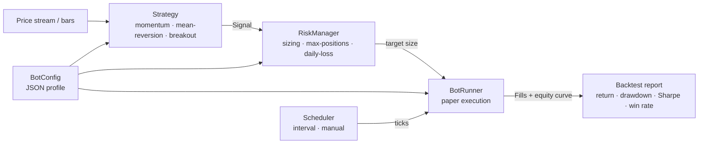

<p align="center">
  
</p>

<h1 align="center">Automated Trading Bot</h1>

<p align="center">
  <strong>A config-driven, scheduled automated trading bot framework — multi-strategy, with hard risk guardrails and a full backtest report, in pure Python.</strong><br>
  Pick a strategy, define a JSON profile, backtest it, then drive it on a clock — no API keys, no network, no real money required.
</p>

<p align="center">
  <em>Built and maintained by <a href="https://viprasol.com">Viprasol Tech</a> — Fintech Experts. Full-Stack Builders.</em>
</p>

<p align="center">
  <a href="https://github.com/Viprasol-Tech/automated-trading-bot/actions/workflows/ci.yml"></a>
  <a href="LICENSE"></a>
  
  
  
  
  
  <a href="https://t.me/viprasol_help"></a>
  <a href="https://github.com/Viprasol-Tech/automated-trading-bot/stargazers"></a>
</p>

---

> ## ⚠️ Disclaimer
> This software is for **educational purposes only** and is **not financial advice**. Trading involves substantial risk, including the **total loss of capital**. Backtest results are **not** indicative of future performance. Always paper-trade first and comply with your venue's terms and your local laws. **Use at your own risk** — Viprasol Tech assumes no responsibility for your trading results.

---

## ✨ Features

- 📈 **Three built-in strategies** — momentum (MA crossover), mean reversion (z-score band), and breakout (Donchian channel), all behind one clean `Strategy` protocol.
- 🛡️ **Hard risk guardrails** — per-position sizing cap, a concurrent-position limit, and a daily-loss kill-switch that flattens the book and halts trading.
- 📊 **Real backtest report** — total return, max drawdown, annualised Sharpe, volatility, and win rate, with a one-call human-readable summary.
- 🗂️ **JSON config profiles** — version-controllable, validated bot configs that round-trip to disk.
- ⏱️ **Pluggable scheduler** — a tiny scheduler abstraction with a real-clock `IntervalScheduler` and a deterministic `ManualScheduler` for tests.
- 🧱 **Pure & offline** — no API keys, no network; the same `signal → size → order` pipeline runs in backtest and live.
- 🧪 **74 tests, strict types** — `ruff`, `mypy --strict`, and `pytest` all green in CI.
- 🖥️ **Rich CLI** — `demo`, `strategies`, `init-config`, `backtest`, and `run` subcommands.

## 🚀 Quickstart

```bash
# Clone and install (editable, with dev tooling)
git clone https://github.com/Viprasol-Tech/automated-trading-bot.git
cd automated-trading-bot
pip install -e ".[dev]"

# See the available strategies
automated-trading-bot strategies

# Backtest the breakout strategy on synthetic data
automated-trading-bot demo --strategy breakout

# Save a config profile, then backtest from it
automated-trading-bot init-config my-bot.json --strategy mean_reversion
automated-trading-bot backtest my-bot.json --bars 240

# Drive the bot on a clock (scheduler-backed)
automated-trading-bot run --ticks 60 --interval 0
```

## 🧑‍💻 Usage (in code)

```python
from automated_trading_bot.config import BotConfig
from automated_trading_bot.backtest import run_backtest

# A validated, JSON-serialisable profile with risk guardrails.
config = BotConfig(
    symbol="BTC/USDT",
    strategy="breakout",  # momentum_ma | mean_reversion | breakout
    slow=30,
    risk_fraction=0.2,  # max 20% of equity per position
    max_positions=1,  # one concurrent position
    daily_loss_limit=0.05,  # halt after a 5% daily drawdown
)

prices = [100.0 + i for i in range(240)]  # your OHLC closes go here
result = run_backtest(config, prices)

print(result.report())
# Backtest report
# ===============
# Starting equity : 10,000.00
# Final equity    : ...
# Sharpe (ann.)   : ...
# Win rate        : ...

# Round-trip the profile to disk and reload it later.
config.to_json_file("my-bot.json")
reloaded = BotConfig.from_json_file("my-bot.json")
```

Drive a live-style loop with the scheduler and risk halt:

```python
from automated_trading_bot.runner import BotRunner
from automated_trading_bot.scheduler import IntervalScheduler

runner = BotRunner(config)
scheduler = IntervalScheduler(interval=1.0)  # one tick per second


def tick(i: int) -> bool:
    runner.on_bar(prices[i])
    return not runner.halted  # stop early if the daily-loss limit fires


scheduler.run(tick, max_ticks=len(prices))
```

## 🏗️ Architecture



## 🧩 API & Modules

| Module | Key API | Responsibility |
| --- | --- | --- |
| `config` | `BotConfig`, `from_json_file`, `to_json_file` | Validated, JSON-serialisable bot profiles |
| `strategy` | `Strategy`, `build_strategy`, `STRATEGIES` | Pure price→signal strategies + registry |
| `risk` | `RiskManager.position_size / can_open / is_halted` | Sizing and risk guardrails |
| `runner` | `BotRunner.on_bar / run / start_new_day` | Signal→size→order paper-trading engine |
| `backtest` | `run_backtest`, `BacktestResult.report` | Performance metrics over a price series |
| `scheduler` | `Scheduler`, `IntervalScheduler`, `ManualScheduler` | Drive the bot on a clock |
| `cli` | `demo`, `strategies`, `init-config`, `backtest`, `run` | Command-line interface |

### Strategies

| Name | Idea | Goes long when… | Exits / shorts when… |
| --- | --- | --- | --- |
| `momentum_ma` | Fast/slow SMA crossover | fast SMA > slow SMA | fast SMA < slow SMA |
| `mean_reversion` | Z-score band fade | price ≤ −`threshold`σ below mean | price ≥ +`threshold`σ above mean |
| `breakout` | Donchian channel | new rolling high | new rolling low |

## 🗺️ Roadmap

- [x] Multiple strategies behind a shared protocol
- [x] Risk guardrails: per-position, max-positions, daily-loss limit
- [x] Backtest report with Sharpe, drawdown, volatility, win rate
- [x] JSON config profiles
- [x] Scheduler abstraction + CLI subcommands
- [ ] Short-selling / long-short account model
- [ ] Pluggable live data feeds and broker adapters
- [ ] Portfolio backtests across multiple symbols
- [ ] Equity-curve plotting and HTML reports

## ❓ FAQ

**Does this trade real money?** No. Execution is simulated in memory — it is a framework and learning tool. Wiring a live feed and broker is left to you (and is your responsibility).

**Where do prices come from?** The CLI uses a synthetic series so demos run offline. In code, pass your own list of closes to `run_backtest` or feed bars to `BotRunner.on_bar`.

**Can I add my own strategy?** Yes — implement the `Strategy` protocol (a `name` and `on_price(price) -> Signal`), add it to the `STRATEGIES` registry, and it works everywhere.

**Are there heavy dependencies?** No. Just `pydantic`, `typer`, and `rich`. Metrics are computed from the standard library.

## 🤝 Contributing

Contributions are welcome! Please open an issue to discuss substantial changes first. Before submitting a PR, make sure the full check suite is green:

```bash
ruff check . && ruff format --check . && mypy src && pytest -q
```

See [CONTRIBUTING.md](CONTRIBUTING.md) and our [Code of Conduct](CODE_OF_CONDUCT.md).

## Contact — Viprasol Tech Private Limited

- Website: [viprasol.com](https://viprasol.com)
- Email: [support@viprasol.com](mailto:support@viprasol.com)
- Telegram: [t.me/viprasol_help](https://t.me/viprasol_help) | WhatsApp: +91 96336 52112
- GitHub: [@Viprasol-Tech](https://github.com/Viprasol-Tech) | [LinkedIn](https://www.linkedin.com/in/viprasol/) | X [@viprasol](https://twitter.com/viprasol)

## License

[MIT](LICENSE) (c) 2025 Viprasol Tech Private Limited
