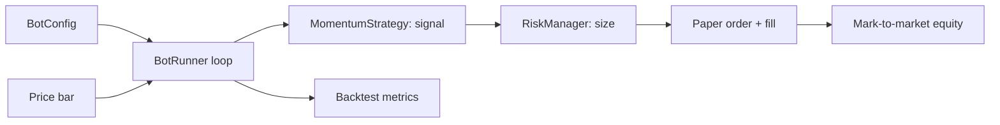

<p align="center">
  
</p>

<h1 align="center">Automated Trading Bot</h1>

<p align="center">
  <strong>A config-driven, scheduled automated trading bot template — with built-in risk management and backtesting, in Python.</strong><br>
  Define a config, pick your moving-average windows, backtest on synthetic data, then wire in a live feed.
</p>

<p align="center">
  <em>Built and maintained by <a href="https://viprasol.com">Viprasol Tech</a> — Fintech Experts. Full-Stack Builders.</em>
</p>

<p align="center">
  <a href="https://github.com/Viprasol-Tech/automated-trading-bot/actions/workflows/ci.yml"></a>
  <a href="LICENSE"></a>
  
  <a href="https://t.me/viprasol_help"></a>
  <a href="https://github.com/Viprasol-Tech/automated-trading-bot/stargazers"></a>
</p>

---

> ## ⚠️ Disclaimer
> This software is for **educational purposes only** and is **not financial advice**. Trading involves substantial risk, including the **total loss of capital**. Backtest results are **not** indicative of future performance. Always paper-trade first and comply with your venue's terms and your local laws. **Use at your own risk** — Viprasol Tech assumes no responsibility for your trading results.

---

## ✨ Features

- ⚙️ **Config-driven** — one validated `BotConfig` (symbol, fast/slow, risk fraction) drives the whole bot.
- 📈 **Momentum strategy** — fast/slow moving-average crossover, pure `price in → signal out`.
- 🛡️ **Risk management** — position sizing capped at `risk_fraction` of current equity, in one tested place.
- 🔁 **Scheduled runner** — a clean per-bar loop: signal → size → paper order → mark-to-market.
- 🧪 **Backtester** — replay any price series and get return, max drawdown, and trade count.
- 🖥️ **CLI** — `automated-trading-bot demo` runs the full pipeline offline.
- 🧰 **Modern tooling** — ruff, mypy (strict), pytest, GitHub Actions CI.

## 🚀 Quickstart

```bash
git clone https://github.com/Viprasol-Tech/automated-trading-bot.git
cd automated-trading-bot
python -m pip install -e ".[dev]"

# Backtest the momentum strategy on a synthetic trending series:
automated-trading-bot demo
automated-trading-bot demo --fast 5 --slow 20 --risk-fraction 0.3
```

## 🧩 Use it in code

```python
from automated_trading_bot.config import BotConfig
from automated_trading_bot.backtest import run_backtest

config = BotConfig(symbol="BTC/USDT", fast=10, slow=30, risk_fraction=0.2)
prices = [100.0 + i for i in range(120)]  # your price series here
result = run_backtest(config, prices)

print(result.total_return, result.max_drawdown, result.num_trades)
```

## 🏗️ Architecture



## 🗺️ Roadmap

- [x] Config-driven `BotConfig` with validation
- [x] Momentum (MA crossover) strategy + capped position sizing
- [x] Per-bar runner + backtester with return & drawdown
- [ ] Pluggable live price feeds and broker adapters
- [ ] Additional strategies (breakout, mean-reversion)
- [ ] Telegram alerts and scheduled deployment recipes

## 🤝 Contributing

PRs welcome — see [CONTRIBUTING.md](CONTRIBUTING.md) and our [Code of Conduct](CODE_OF_CONDUCT.md).

## Contact — Viprasol Tech Private Limited

- Website: [viprasol.com](https://viprasol.com)
- Email: [support@viprasol.com](mailto:support@viprasol.com)
- Telegram: [t.me/viprasol_help](https://t.me/viprasol_help) | WhatsApp: +91 96336 52112
- GitHub: [@Viprasol-Tech](https://github.com/Viprasol-Tech) | [LinkedIn](https://www.linkedin.com/in/viprasol/) | X [@viprasol](https://twitter.com/viprasol)

## License

[MIT](LICENSE) (c) 2025 Viprasol Tech Private Limited
